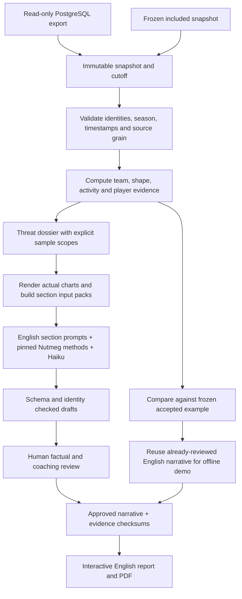

# From source data to player briefing

## What runs at each stage?

| Stage | Code | Files written | External access |
| --- | --- | --- | --- |
| Acquire | `pipeline/export_snapshot.py`, `snapshot_queries.json` | `snapshot.json`, `coverage.json` | Read-only PostgreSQL only |
| Evidence | `pipeline/build_evidence.py`, `data.py` | `evidence.json` | None |
| Contributions | `pipeline/build_threat_dossier.py` | `threat-dossier.json` | None |
| Section inputs | `sections/*/pipeline.py`, `pipeline/sections.py` | `input.json` / `section_input.json` | None |
| Charts | `pipeline/render.py`, `pipeline/assets/` | PNGs, manifest, HTML | Local browser |
| Generate | `pipeline/sections.py`, `bedrock.py` | `request.json`, schema, model response, generation metadata | Bedrock, except About; dry-run makes no call |
| Review | `run.py approve` | `reviewed-narrative.json`, `review.json` | None |
| Render | `run.py render`, `pipeline/render.py` | HTML, assets, PNGs, PDF, browser checks | Local browser |

The frozen demo follows the lower branch. It recomputes the numbers but reuses
reviewed prose after evidence parity checks. A new analysis follows the Haiku
branch and needs factual review. These paths are intentionally explicit.

Generation order differs from display order: awareness uses the other draft
analyses as context, and verdict is written last. Previous drafts never become
additional numeric evidence. About is deterministic metadata.
