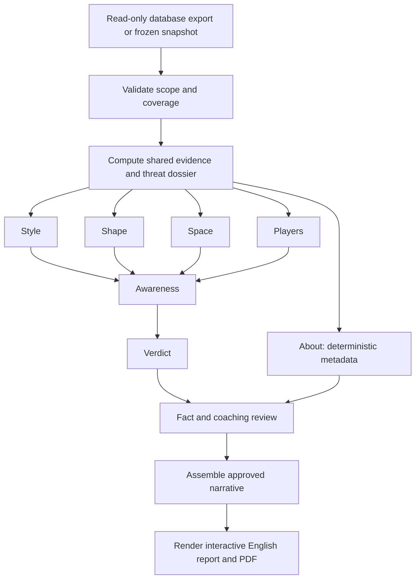

# Section map and generation order

Display order follows the accepted prototype. Generation order respects dependencies.

| Display order | Section ID | Folder | Output | Depends on |
| --- | --- | --- | --- | --- |
| 0 | `verdict` | `sections/00_verdict/` | Top match briefing | Other analyses and awareness |
| 1 | `style` | `sections/01_how_they_play/` | Team profile and response | Computed evidence |
| 2 | `shape` | `sections/02_their_shape/` | Recent/home/away position notes and three chart explanations | Computed evidence |
| 3 | `space` | `sections/03_where_they_play/` | Season/recent activity notes and two chart explanations | Computed evidence |
| 4 | `players` | `sections/04_key_players/` | Main profiles, extra threats and key-player radar explanations | Scores, covered rates and threat dossier |
| 5 | `awareness` | `sections/05_awareness/` | Match cues, actions and optional proposed drills | Style, shape, space and players |
| 6 | `about` | `sections/06_about/` | Scope, disclosures and provenance | Evidence and review metadata; no model call |



## Per-section contract

Every section folder exposes the same functions in `pipeline.py`:

```python
get_input(evidence, prior_analysis=None)  # section evidence and context
extract(narrative, evidence, provenance=None)  # approved example section
validate(result, evidence)  # structural/identity validation, raises on failure
```

Use these wrappers or the root runner rather than executing a section file directly. They share `pipeline.sections` so every section follows the same source and identity checks.

The nine chart identities are `shape-last5`, `shape-home`, `shape-away`, `space-season`, `space-last5`, and `key-<player_id>` for the four supplied key players. Each needs exactly one written explanation. The assembly step maps these identities to the renderer's global chart indexes; the model must not invent chart IDs.

## What can be changed independently?

- Edit a section prompt to change its writing instructions for future drafts.
- Edit its logic document together with the actual shared computation when changing a metric or filter.
- Regenerate that section as a draft, review it, then refresh downstream awareness/verdict if the preparation plan changes.
- Refresh evidence before generating any section for a new player, match or cutoff.
- Keep the reviewed example frozen; it is an example, not a template filled by changing names.
